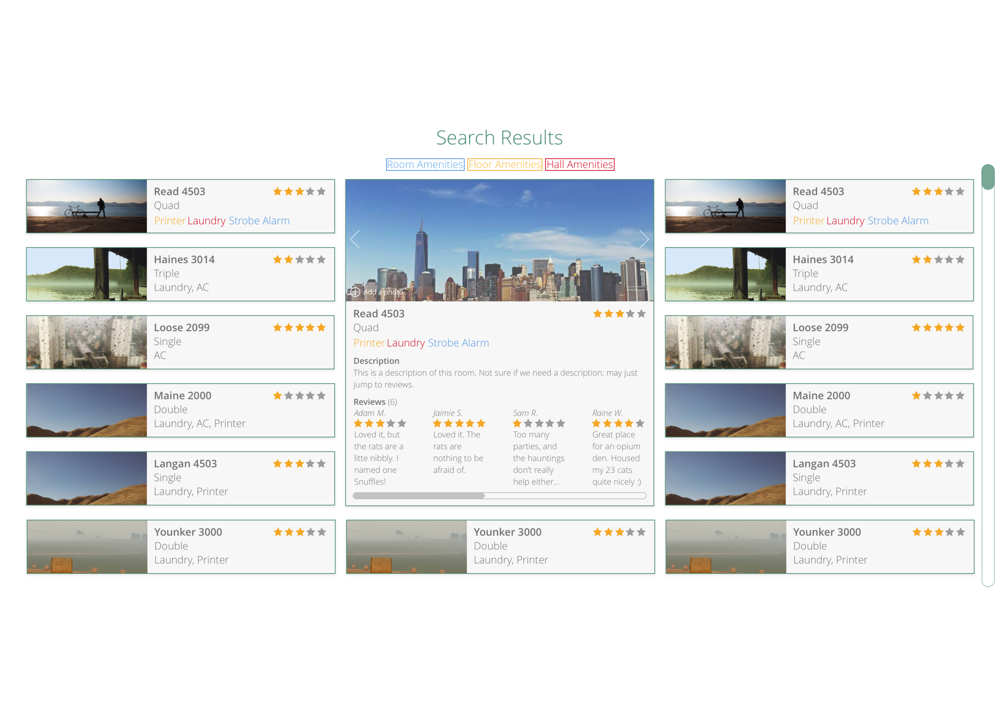
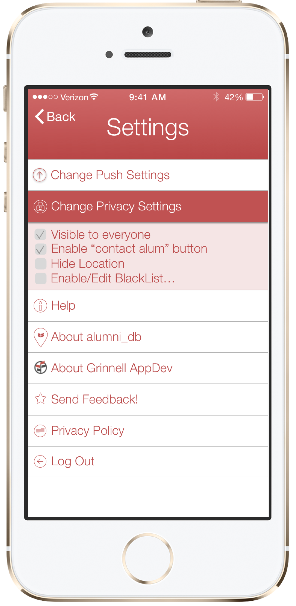
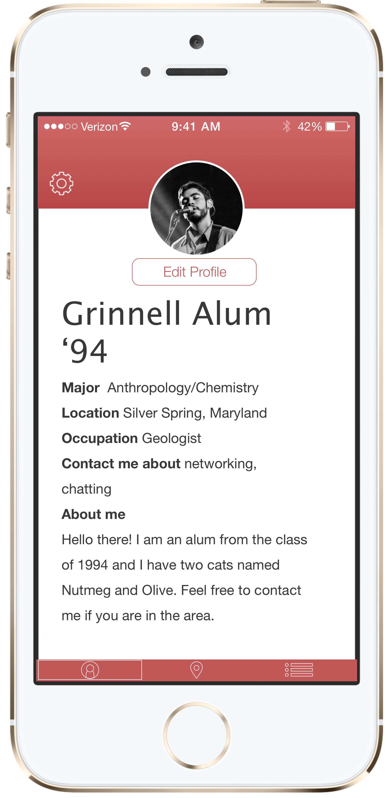
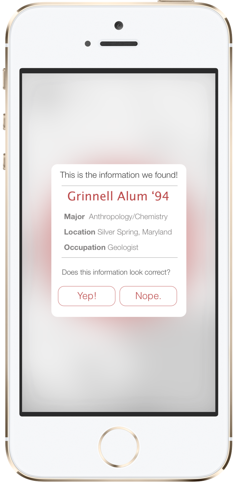
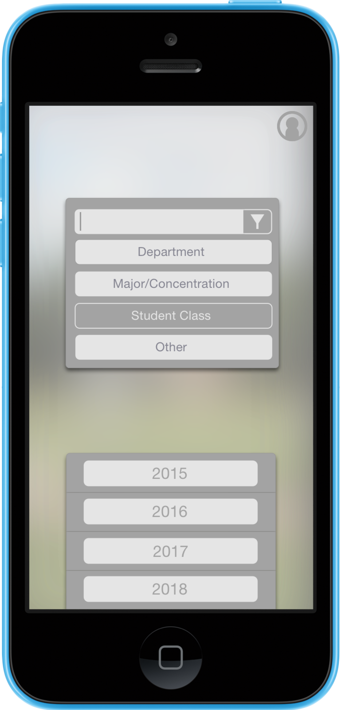
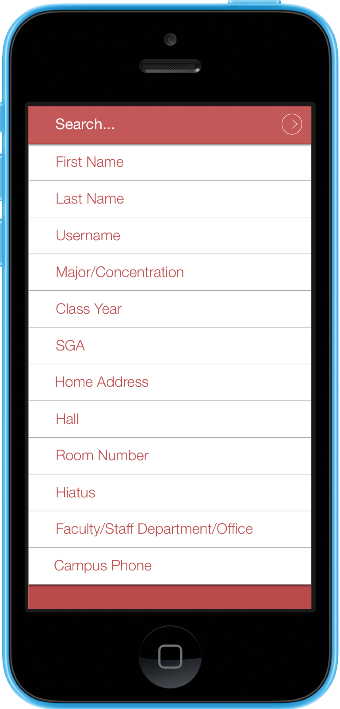
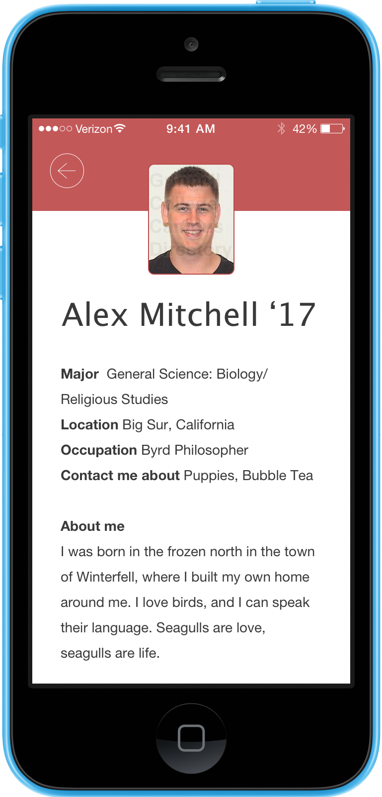

As Design Lead at Grinnell AppDev, I hired and managed the group's UI and UX designers, built and taught a six-week design curriculum for new hires, and weighed in on organizational and project-level decisions. Day to day, that meant guiding UI, interaction design, and UX choices as our student developers shipped mobile and web apps for the rest of campus.

Here are a few of the things I helped create.

## Dorms DB

Dorms DB was a residence-life room-choice network: students at any subscribed college could filter, view, rate, and sign up for rooms on their own campus. I designed the front end in Spring 2015 — a flat, simple layout built for easy institutional re-skinning.

## AppDev Members Page

Drawing on staff pages from a handful of startups, I designed, iterated on, and pitched a grid-based members page for Grinnell AppDev. Color coded each person's role, with a hover-over revealing their details. The group's team count was high, including a growing list of alumni we wanted to keep visible, and the grid format suited that well.

## Alumni DB

Alumni DB was an alumni-exclusive social app meant to give current Grinnell students and alumni a central place to find each other and connect — three-panel navigation, no wasted UI elements. It was canceled after the prototype stage when funding fell through.

## DB

DB was a refresh of AppDev's most popular app: a campus-wide people directory. It got a UI and interaction redesign built around nested list selection, aimed at making it faster and more pleasant to look someone up.

