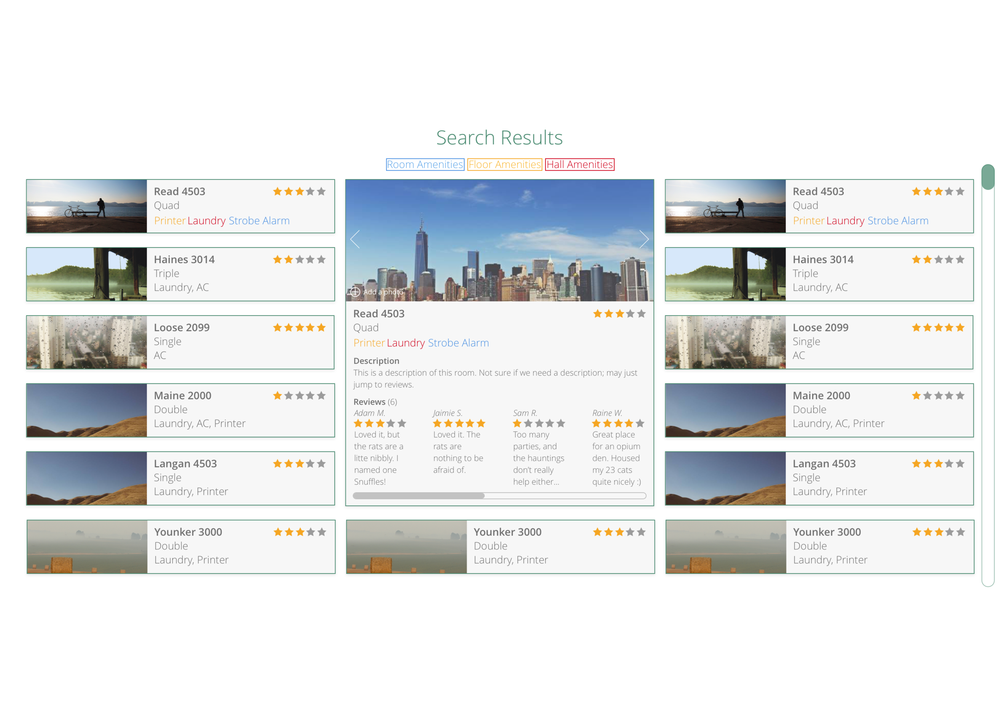
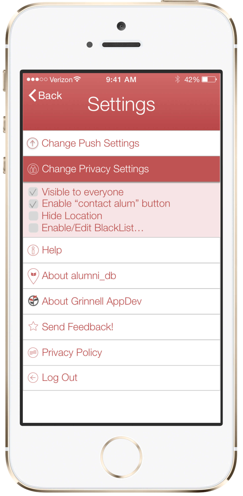
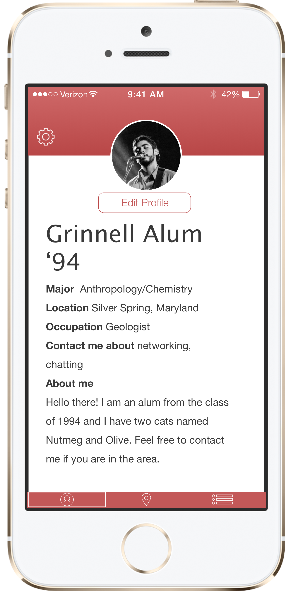
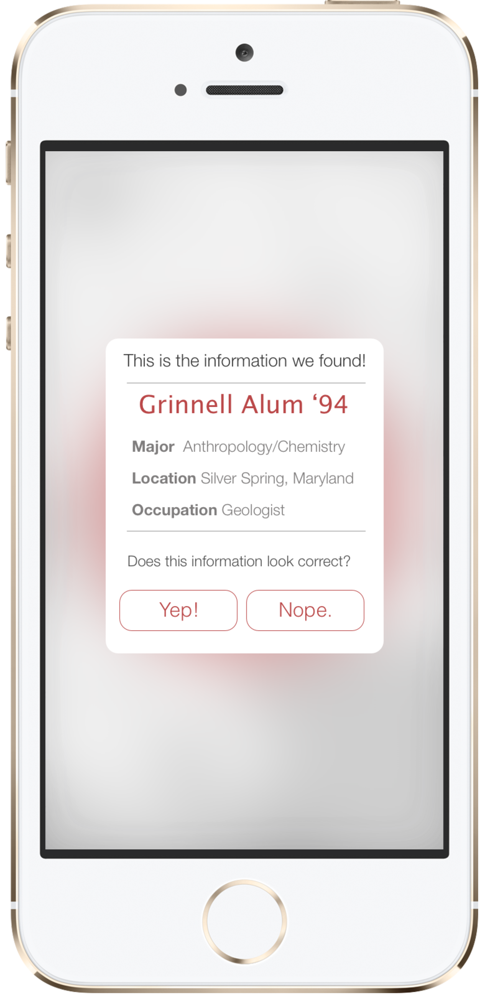
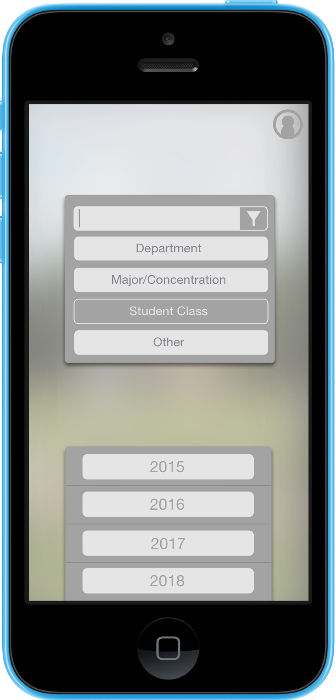
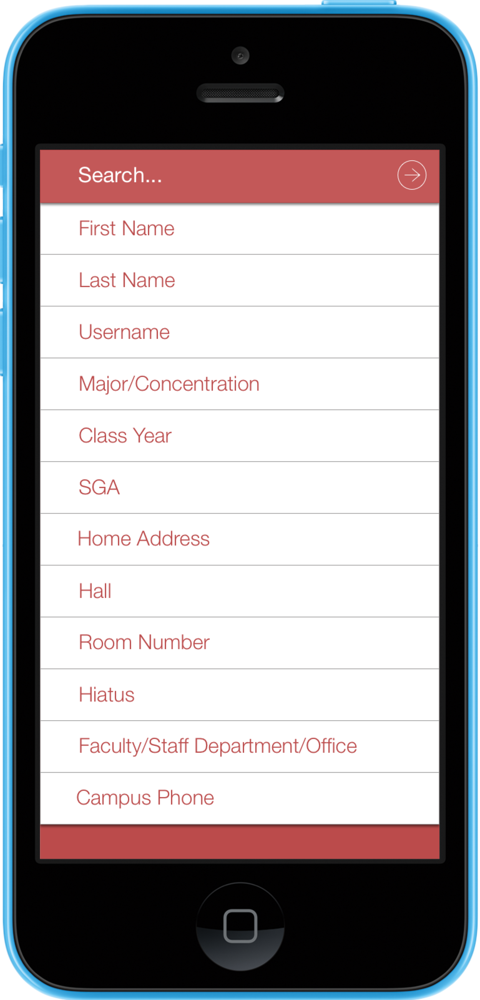
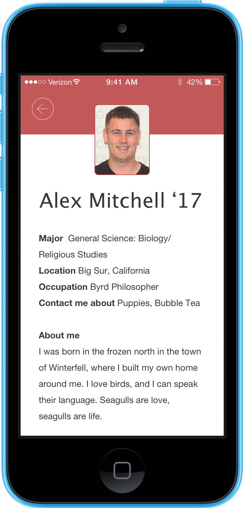

At Grinnell AppDev, I hired and managed our design team and worked with student developers on mobile and web apps for campus.

## Dorms DB

Dorms DB let students browse, rate, and sign up for rooms on their own campus. I designed the front end in spring 2015 so each participating college could apply its own branding.

## AppDev Members Page

Drawing on staff pages from a handful of startups, I designed, iterated on, and pitched a grid-based members page for Grinnell AppDev. I used color to show each person’s role and revealed their details on hover. The grid gave us room to keep a growing list of alumni visible.

## Alumni DB

Alumni DB was an alumni-exclusive social app meant to give current Grinnell students and alumni a central place to find each other and connect. It was canceled after the prototype stage when funding fell through.

## DB

DB was a refresh of AppDev's most popular app: a campus-wide people directory. I helped redesign the search and filters so students could look people up by details like their major, residence hall, or room number.

