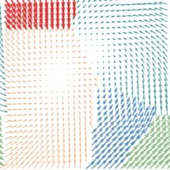
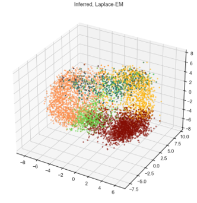
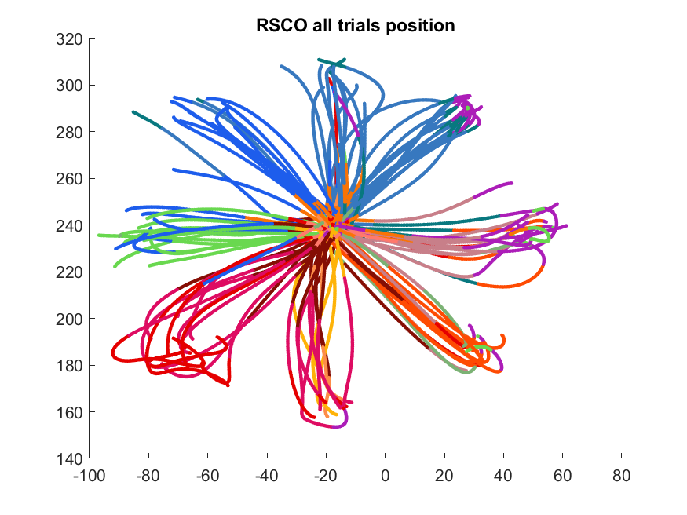

How do you condense a decade of neuroscience into one entry on a personal website? You don't, really — you pick the four projects that still feel true to what you were doing, and you let them stand for the rest. From 2013 to 2023 I moved through primate neuroimaging infrastructure, chronic electrode reliability, and the theory of how motor cortex organizes a movement. All of it was in service of the same underlying question: how does the brain structure intention, and how do we build technology that can read it. Here's the abridged version, project by project.

## NIMH Macaque Template

As a post-baccalaureate fellow at the National Institute of Mental Health, I worked on a small team led by Adam Messinger and Jakob Seidlitz — alongside Daniel Glen, Frank Ye, Kathleen Saleem, David Leopold, and Leslie Ungerleider — to fix a problem that was quietly slowing down an entire field: non-human primate MRI research had no shared standard, so it was hard to combine data across subjects, let alone across labs. We combined 31 individual macaque brain scans into one standardized, high-resolution "average" brainspace, using ANTs for the nonlinear alignment and a set of Python and Bash scripts, built on top of AFNI, to make the whole pipeline usable by other researchers rather than just us.

The result — the NMT, or NIMH Macaque Template — shipped at four times the resolution of the templates it replaced, and was the first to hook directly into AFNI/SUMA for downstream analysis, automatically segmenting gray matter, white matter, and other tissue classes along the way. It's since become the de facto standard for the field: the paper has been cited well over 120 times, and a major update with hierarchical anatomical atlases shipped about a year after I left the project. My own role ran the full width of the work — stakeholder communication, secondary research, writing, and the visualizations that explained it.

## Array Stability

Back at the University of Chicago, working with Nicho Hatsopoulos and postdoc Vassilios Papadourakis, I went after a practical question nobody had really measured well: how long does a Utah array — the intracortical microelectrode array behind most chronic neural recordings — actually keep producing usable signal? Working with John Downey, Jennifer Collinger, and Jeff Weiss at the University of Pittsburgh, we extended the analysis beyond our own lab's data to arrays implanted in human research participants, which let us compare across species and settings instead of guessing from a handful of examples.

Across more than 6,000 recording sessions spanning almost nine years, we tracked signal-to-noise ratio per channel over the life of each implant. The average array stayed useful for 622 days, and human implants outlasted non-human primate implants. Electrode length turned out not to matter much, but tip material did — platinum-tipped electrodes held up better than iridium oxide over time. Nearly 70% of arrays kept at least 40% of their channels usable in the first three months, and about half still cleared that bar a year in, with yield dropping roughly 2% every 30 days by our regression. The paper has become one of the reference points other labs use to set expectations for how much good data they'll get out of a chronic implant before it degrades.

## Brain Dynamics

My dissertation work asked a more theoretical question: how does primary motor cortex actually structure a movement command? Rather than treating a reach as one continuous signal, I used Hidden Markov Models to break population activity into discrete "population states," then layered latent-variable models on top to capture how firing rates and neural trajectories shifted within each state.

The headline finding was that acceleration and deceleration aren't just two ends of the same command — the brain represents them as genuinely distinct population states, with dynamics dissimilar enough that you can tell them apart from the shape of the neural trajectory alone, before you even look at the movement it produced. That matters past the theory: motor cortex is the same signal source most brain-machine interfaces decode from, so a better model of how it's structured is a better foundation for decoding it.

## Brain-Machine Interfaces

There's no separate write-up for this one — the live page for it never grew past a placeholder. But it was always the throughline, not a fourth, independent project: the template infrastructure, the electrode-longevity work, and the population-dynamics theory were all groundwork for the same eventual goal — decoding intended movement from cortex well enough to give it back to someone who's lost it. If the other three projects have a "why," this is it.

My peer-reviewed publications can be found on my Google Scholar profile:
https://scholar.google.com/citations?user=4ITS-ScAAAAJ&
