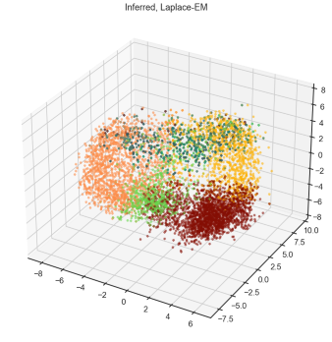
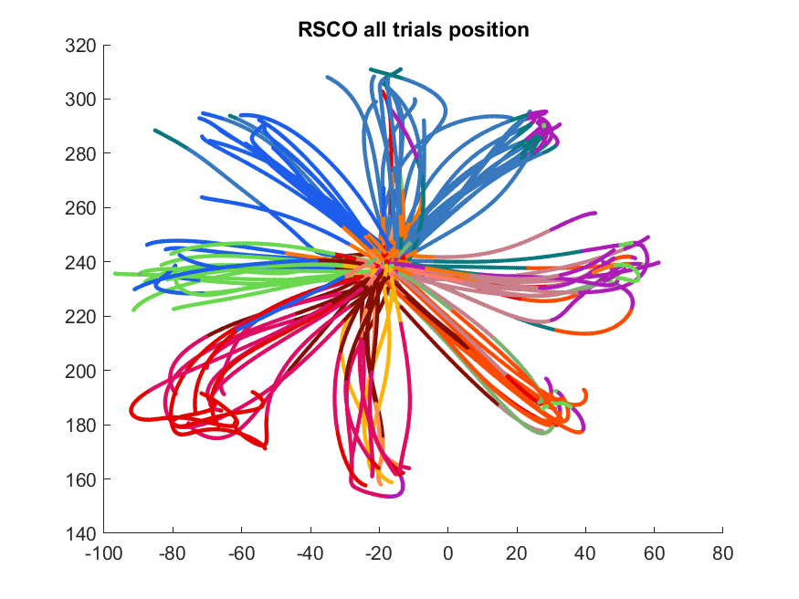

How long can a brain implant keep recording usable signals? Can you tell whether someone is speeding up or slowing down a reach from brain activity alone? I worked on these questions between 2013 and 2023, alongside projects to build brain–machine interfaces and make it easier for labs to compare primate MRI scans.

[See my publications on Google Scholar](https://scholar.google.com/citations?user=4ITS-ScAAAAJ).

## Brain-Machine Interfaces
I joined a collaboration between the University of Chicago and the University of Pittsburgh to build brain–machine interfaces that let people with spinal cord injuries control virtual and robotic limbs. As one contributor to a larger collaboration, I helped build the rigs, write code, troubleshoot the virtual reality headsets, and work with our first human participant, Scott.

Brain-machine interfaces were a big part of why I went to graduate school. This was the closest I got to that work, and it was slow, difficult, and dependent on a lot of people working together. Eventually, I had to step back from the project to finish my dissertation.

## NIMH Macaque Template

As a post-baccalaureate fellow at the National Institute of Mental Health, I worked on a small team led by Adam Messinger and Jakob Seidlitz, alongside Daniel Glen, Frank Ye, Kathleen Saleem, David Leopold, and Leslie Ungerleider, to fix a problem that was quietly slowing down an entire field: non-human primate MRI research had no shared standard, so it was hard to combine data across subjects, let alone across labs. We combined 31 individual macaque brain scans into one standardized, high-resolution "average" brainspace, using ANTs for the nonlinear alignment and a set of Python and Bash scripts, built on top of AFNI, to make the whole pipeline usable by other researchers rather than just us.

The result, the NMT, or NIMH Macaque Template, shipped at four times the resolution of the templates it replaced, and was the first to hook directly into AFNI/SUMA for downstream analysis, automatically segmenting gray matter, white matter, and other tissue classes along the way. It's since become the de facto standard for the field: the paper has been cited well over 120 times, and a major update with hierarchical anatomical atlases shipped about a year after I left the project. My own role ran the full width of the work: stakeholder communication, secondary research, writing, and the visualizations that explained it.

## Array Stability

Back at the University of Chicago, working with Nicho Hatsopoulos and postdoc Vassilios Papadourakis, I studied how long a Utah array, an implant used to record brain activity, keeps producing a usable signal. Working with John Downey, Jennifer Collinger, and Jeff Weiss at the University of Pittsburgh, we extended the analysis beyond our own lab's data to arrays implanted in human research participants, which let us compare across species and settings instead of guessing from a handful of examples.

Across more than 6,000 recording sessions spanning almost nine years, we tracked signal-to-noise ratio per channel over the life of each implant. The average array stayed useful for 622 days, and human implants outlasted non-human primate implants. Electrode length turned out not to matter much, but tip material did — platinum-tipped electrodes held up better than iridium oxide over time. Nearly 70% of arrays kept at least 40% of their channels usable in the first three months, and about half still cleared that bar a year in, with yield dropping roughly 2% every 30 days by our regression. The paper has become one of the reference points other labs use to set expectations for how much good data they'll get out of a chronic implant before it degrades.

## Brain Dynamics

My dissertation work asked a more theoretical question: how does primary motor cortex actually structure a movement command? Rather than treating a reach as one continuous signal, I used Hidden Markov Models to break population activity into discrete "population states," then layered latent-variable models on top to capture how firing rates and neural trajectories shifted within each state.

Acceleration and deceleration corresponded to distinct patterns of brain activity. I could tell them apart from the shape of the neural trajectory alone, without looking at the movement. Motor cortex supplies the signals that many brain–machine interfaces use, so understanding those patterns could help improve how the devices interpret them.

